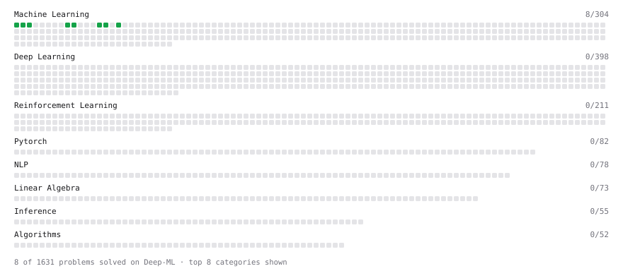

# Deep-ML

My machine learning practice from [Deep-ML](https://www.deep-ml.com). Every solution here was written by hand.

**48** solved · 48 problems · 0 labs · 0 math

[**Browse the interactive portfolio**](https://tan1729.github.io/deep-ml/) to replay this filling in over time.

## Problems

| | Difficulty | Solved | |
| --- | --- | --- | --- |
| [Balance Dataset via Undersampling](https://www.deep-ml.com/problems/1057) | easy | 2026-10-30 | [solution](problems/1057-balance-dataset-via-undersampling) |
| [Batch Iterator for Dataset](https://www.deep-ml.com/problems/30) | easy | 2026-10-20 | [solution](problems/0030-batch-iterator-for-dataset) |
| [Bernoulli Masking Schedule for Masked Token Prediction](https://www.deep-ml.com/problems/708) | easy | 2026-10-29 | [solution](problems/0708-bernoulli-masking-schedule-for-masked-token-prediction) |
| [Binary Classification with Logistic Regression](https://www.deep-ml.com/problems/104) | easy | 2026-10-25 | [solution](problems/0104-binary-classification-with-logistic-regression) |
| [Build a Latent-to-Real Action Mapping from a Small Labeled Set](https://www.deep-ml.com/problems/716) | easy | 2026-10-29 | [solution](problems/0716-build-a-latent-to-real-action-mapping-from-a-small-labeled-set) |
| [Calculate Accuracy Score](https://www.deep-ml.com/problems/36) | easy | 2026-10-21 | [solution](problems/0036-calculate-accuracy-score) |
| [Calculate Dice Score for Classification](https://www.deep-ml.com/problems/73) | easy | 2026-10-22 | [solution](problems/0073-calculate-dice-score-for-classification) |
| [Calculate F1 Score from Predicted and True Labels](https://www.deep-ml.com/problems/91) | easy | 2026-10-22 | [solution](problems/0091-calculate-f1-score-from-predicted-and-true-labels) |
| [Calculate Jaccard Index for Binary Classification](https://www.deep-ml.com/problems/72) | easy | 2026-10-22 | [solution](problems/0072-calculate-jaccard-index-for-binary-classification) |
| [Calculate Mean Absolute Error (MAE)](https://www.deep-ml.com/problems/93) | easy | 2026-10-22 | [solution](problems/0093-calculate-mean-absolute-error-mae) |
| [Calculate R-squared for Regression Analysis](https://www.deep-ml.com/problems/69) | easy | 2026-10-21 | [solution](problems/0069-calculate-r-squared-for-regression-analysis) |
| [Calculate Root Mean Square Error (RMSE)](https://www.deep-ml.com/problems/71) | easy | 2026-10-21 | [solution](problems/0071-calculate-root-mean-square-error-rmse) |
| [Calculate SVM Margin Width](https://www.deep-ml.com/problems/282) | easy | 2026-10-28 | [solution](problems/0282-calculate-svm-margin-width) |
| [Combined RM and LLM Quality Filter](https://www.deep-ml.com/problems/794) | easy | 2026-10-30 | [solution](problems/0794-combined-rm-and-llm-quality-filter) |
| [Compute TTFT ITL and TPS from a Token Timestamp Stream](https://www.deep-ml.com/problems/411) | easy | 2026-10-29 | [solution](problems/0411-compute-ttft-itl-and-tps-from-a-token-timestamp-stream) |
| [Data Collection from Procedurally Generated RL Environments](https://www.deep-ml.com/problems/722) | easy | 2026-10-30 | [solution](problems/0722-data-collection-from-procedurally-generated-rl-environments) |
| [Detect Overfitting or Underfitting](https://www.deep-ml.com/problems/86) | easy | 2026-10-22 | [solution](problems/0086-detect-overfitting-or-underfitting) |
| [Early Stopping Based on Validation Loss Plateau](https://www.deep-ml.com/problems/199) | easy | 2026-10-26 | [solution](problems/0199-early-stopping-based-on-validation-loss-plateau) |
| [ExponentialLR Learning Rate Scheduler](https://www.deep-ml.com/problems/154) | easy | 2026-10-26 | [solution](problems/0154-exponentiallr-learning-rate-scheduler) |
| [Feature Scaling Implementation](https://www.deep-ml.com/problems/16) | easy | 2026-10-19 | [solution](problems/0016-feature-scaling-implementation) |
| [Generate a Confusion Matrix for Binary Classification](https://www.deep-ml.com/problems/75) | easy | 2026-10-22 | [solution](problems/0075-generate-a-confusion-matrix-for-binary-classification) |
| [Gradient Checkpointing](https://www.deep-ml.com/problems/188) | easy | 2026-10-26 | [solution](problems/0188-gradient-checkpointing) |
| [Gradient Direction and Magnitude](https://www.deep-ml.com/problems/308) | easy | 2026-10-28 | [solution](problems/0308-gradient-direction-and-magnitude) |
| [Implement Early Stopping Based on Validation Loss](https://www.deep-ml.com/problems/135) | easy | 2026-10-26 | [solution](problems/0135-implement-early-stopping-based-on-validation-loss) |
| [Implement F-Score Calculation for Binary Classification](https://www.deep-ml.com/problems/61) | easy | 2026-10-21 | [solution](problems/0061-implement-f-score-calculation-for-binary-classification) |
| [Implement Gini Impurity Calculation for a Set of Classes](https://www.deep-ml.com/problems/64) | easy | 2026-10-21 | [solution](problems/0064-implement-gini-impurity-calculation-for-a-set-of-classes) |
| [Implement Hard Voting Classifier](https://www.deep-ml.com/problems/305) | easy | 2026-10-28 | [solution](problems/0305-implement-hard-voting-classifier) |
| [Implement Hinge Loss for SVM](https://www.deep-ml.com/problems/283) | easy | 2026-10-28 | [solution](problems/0283-implement-hinge-loss-for-svm) |
| [Implement Polynomial Kernel Function](https://www.deep-ml.com/problems/281) | easy | 2026-10-26 | [solution](problems/0281-implement-polynomial-kernel-function) |
| [Implement Precision Metric](https://www.deep-ml.com/problems/46) | easy | 2026-10-21 | [solution](problems/0046-implement-precision-metric) |
| [Implement Recall Metric in Binary Classification](https://www.deep-ml.com/problems/52) | easy | 2026-10-21 | [solution](problems/0052-implement-recall-metric-in-binary-classification) |
| [Implement Ridge Regression Loss Function](https://www.deep-ml.com/problems/43) | easy | 2026-10-21 | [solution](problems/0043-implement-ridge-regression-loss-function) |
| [Linear Kernel Function](https://www.deep-ml.com/problems/45) | easy | 2026-10-21 | [solution](problems/0045-linear-kernel-function) |
| [Linear Learning Rate Decay](https://www.deep-ml.com/problems/377) | easy | 2026-10-28 | [solution](problems/0377-linear-learning-rate-decay) |
| [Linear Regression Using Gradient Descent](https://www.deep-ml.com/problems/15) | easy | 2026-10-19 | [solution](problems/0015-linear-regression-using-gradient-descent) |
| [Linear Regression Using Normal Equation](https://www.deep-ml.com/problems/14) | easy | 2026-10-19 | [solution](problems/0014-linear-regression-using-normal-equation) |
| [Macro-Average Accuracy Across Benchmark Subtasks](https://www.deep-ml.com/problems/797) | easy | 2026-10-30 | [solution](problems/0797-macro-average-accuracy-across-benchmark-subtasks) |
| [Measure Disorder in Apple Colors](https://www.deep-ml.com/problems/108) | easy | 2026-10-25 | [solution](problems/0108-measure-disorder-in-apple-colors) |
| [One-Hot Encoding of Nominal Values](https://www.deep-ml.com/problems/34) | easy | 2026-10-20 | [solution](problems/0034-one-hot-encoding-of-nominal-values) |
| [Prefix Cache Hit Rate Calculator](https://www.deep-ml.com/problems/434) | easy | 2026-10-29 | [solution](problems/0434-prefix-cache-hit-rate-calculator) |
| [Quality Filtering with Rejection Sampling](https://www.deep-ml.com/problems/508) | easy | 2026-10-29 | [solution](problems/0508-quality-filtering-with-rejection-sampling) |
| [Random Shuffle of Dataset](https://www.deep-ml.com/problems/29) | easy | 2026-10-20 | [solution](problems/0029-random-shuffle-of-dataset) |
| [Rejection Sampling Best-of-K Selection](https://www.deep-ml.com/problems/768) | easy | 2026-10-30 | [solution](problems/0768-rejection-sampling-best-of-k-selection) |
| [RL Training Experiment Tracking](https://www.deep-ml.com/problems/679) | easy | 2026-10-29 | [solution](problems/0679-rl-training-experiment-tracking) |
| [Shift and Scale Array to Target Range](https://www.deep-ml.com/problems/141) | easy | 2026-10-26 | [solution](problems/0141-shift-and-scale-array-to-target-range) |
| [StepLR Learning Rate Scheduler](https://www.deep-ml.com/problems/153) | easy | 2026-10-26 | [solution](problems/0153-steplr-learning-rate-scheduler) |
| [Taylor Series Approximation](https://www.deep-ml.com/problems/310) | easy | 2026-10-28 | [solution](problems/0310-taylor-series-approximation) |
| [Top Quartile Reward Score Filter](https://www.deep-ml.com/problems/778) | easy | 2026-10-30 | [solution](problems/0778-top-quartile-reward-score-filter) |

---

_This file is regenerated by Deep-ML on every push._
